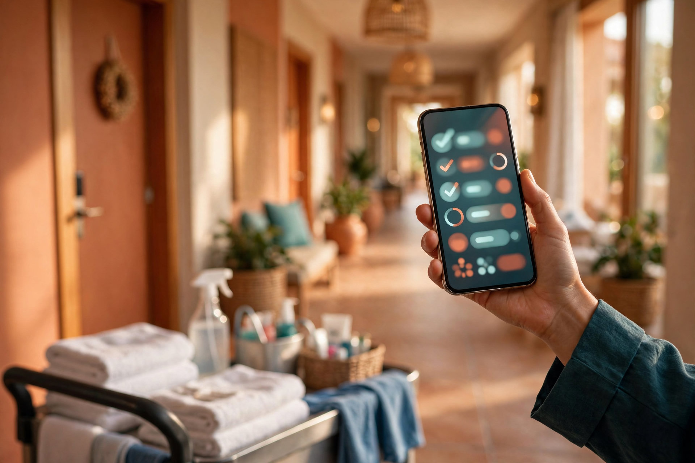
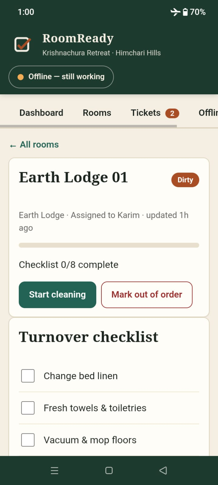
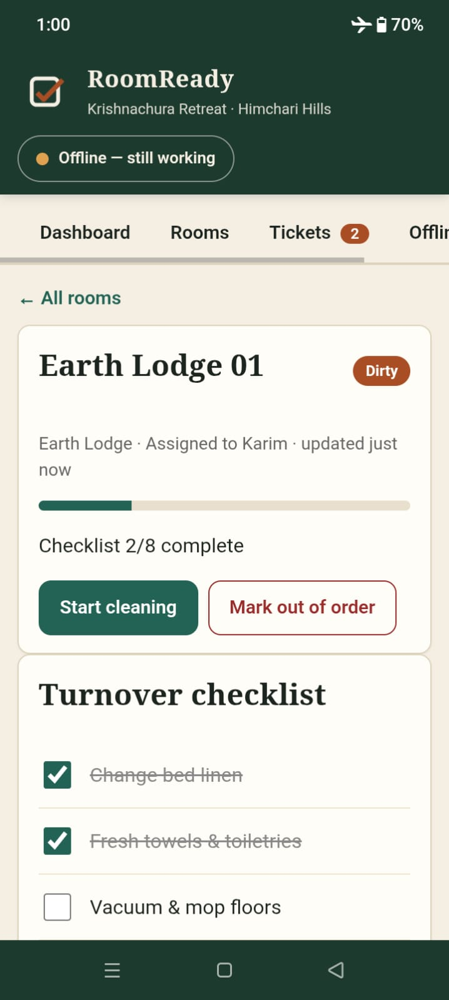
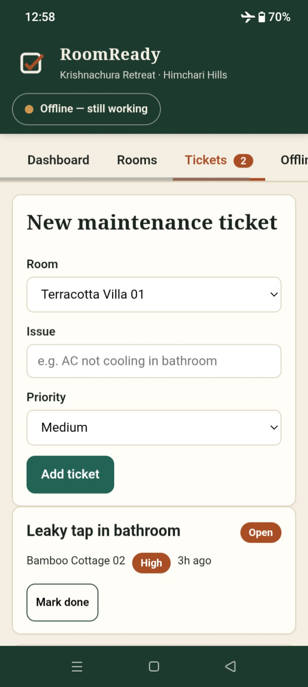
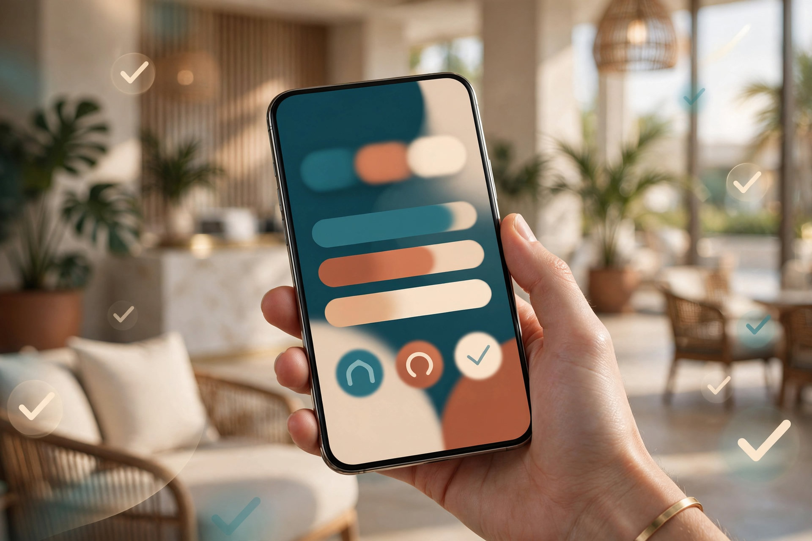

  

<h1 align="center">RoomReady</h1>

  <strong>Every room ready.</strong> 
  Offline-first housekeeping for resorts — rooms, turnover checklists, and
  maintenance tickets that work with zero internet. 
  A ViveReply Suite product.

  
  
  
  
  

  <strong><a href="https://swopno1.github.io/roomready/">Try the live demo</a></strong> · <strong><a href="https://youtube.com/shorts/ziCT43-OXW4">Watch the demo video</a></strong>

## What it does

- **21 rooms, 5 room types** with live status (Ready / Dirty / Cleaning /
  Inspected / Out of order), search, and status filter.
- **Turnover checklists** — 8 steps per room, tap to tick, progress bars,
  room notes. Status advances Dirty → Cleaning → Inspected → Ready.
- **Maintenance tickets** — create, prioritise (Low → Urgent), resolve.
- **Dashboard** — what's ready, what's dirty, what needs attention now.
- **Offline-proof page** — live network state, service-worker state, and
  on-device storage size. The receipts for every claim on this page.

## Proof: filmed in airplane mode

| Dirty room, no signal | Checklist ticked offline | Ticket filed offline |
|---|---|---|
|  |  |  |

*▶ Watch the clip: the full turnover flow with the network off.*

## The airplane-mode test (60 seconds)

1. Open the demo and load once.
2. Turn on airplane mode. The badge flips to *Offline — still working*.
3. Reload. Rooms load, checklists tick, tickets save.
4. DevTools → Network: **zero remote requests**. Everything is local.

## How the offline works

- **Zero dependencies.** No CDN, no fonts, no analytics, no `fetch()` at all.
  ~650 lines of vanilla HTML/CSS/JS, no framework, no build step.
- **Service worker.** Cache-first: the whole app cached on first load, served
  from cache on every later load — online or off.
- **On-device storage.** Rooms, checklists, and tickets live in
  `localStorage`. Nothing leaves the device, ever.
- **Installable.** Valid manifest, maskable + Apple icons, add-to-homescreen
  ready. Any static host works (`python3 -m http.server 8000`).

## Where this goes

RoomReady is day one of a bigger plan:

- **Native Android app** — the same offline engine as a Play Store app with
  push notifications for urgent tickets and assignments.
- **ViveReply Suite integration** — rooms, bookings, and staff flow in from
  [app.vivereply.com](https://app.vivereply.com); turnover status and tickets
  sync back when the device is online. Check-in stays blocked until the room
  is Ready.
- **Part of the ViveReply family** — alongside [vivereply.com](https://vivereply.com)
  and [ViveReply Concierge](https://github.com/swopno1/vivereply-concierge),
  one connected platform for resorts that works with or without a signal.

## License

MIT — see [LICENSE](LICENSE).
